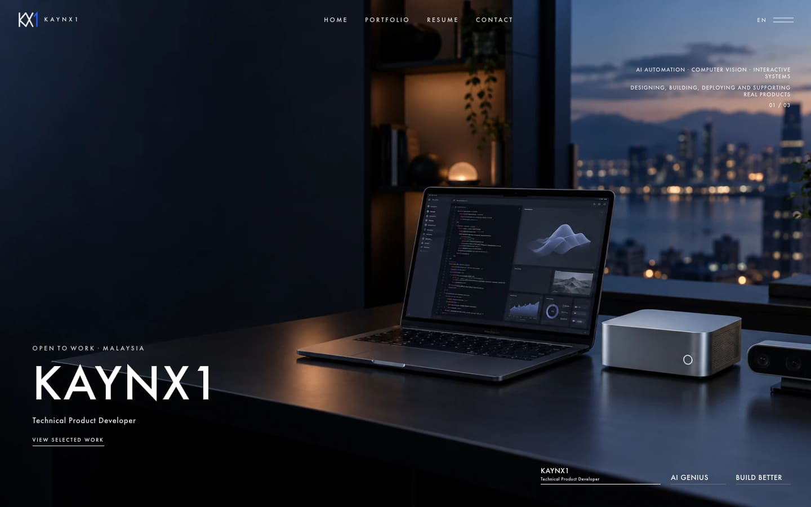
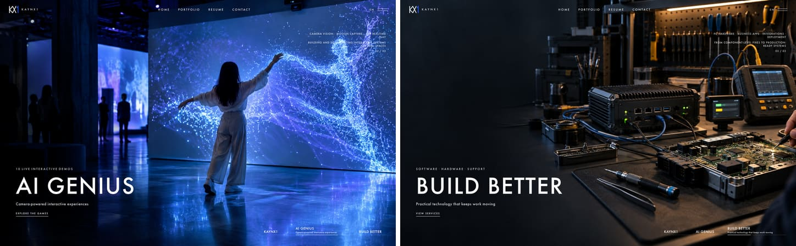
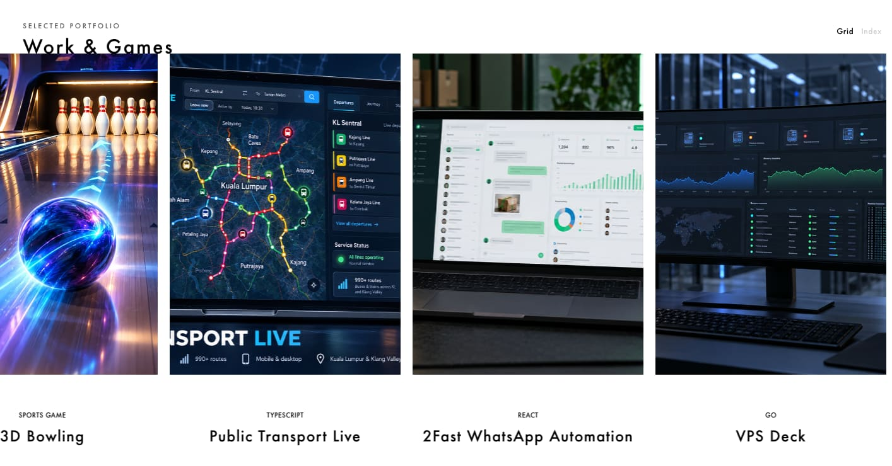
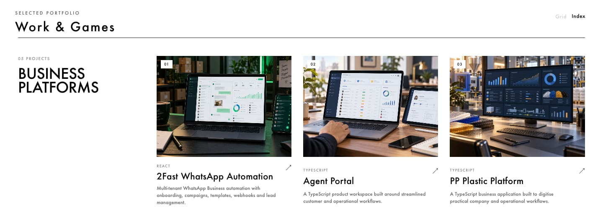
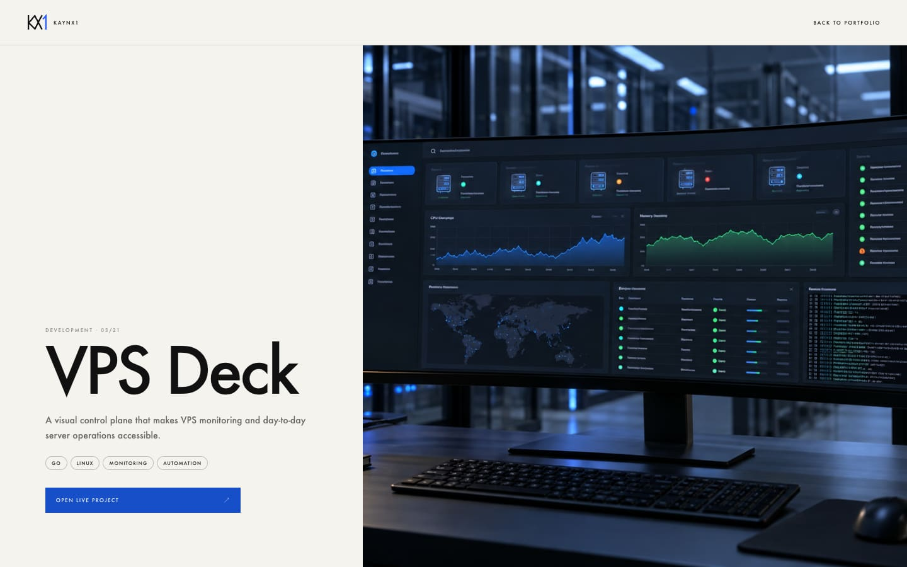
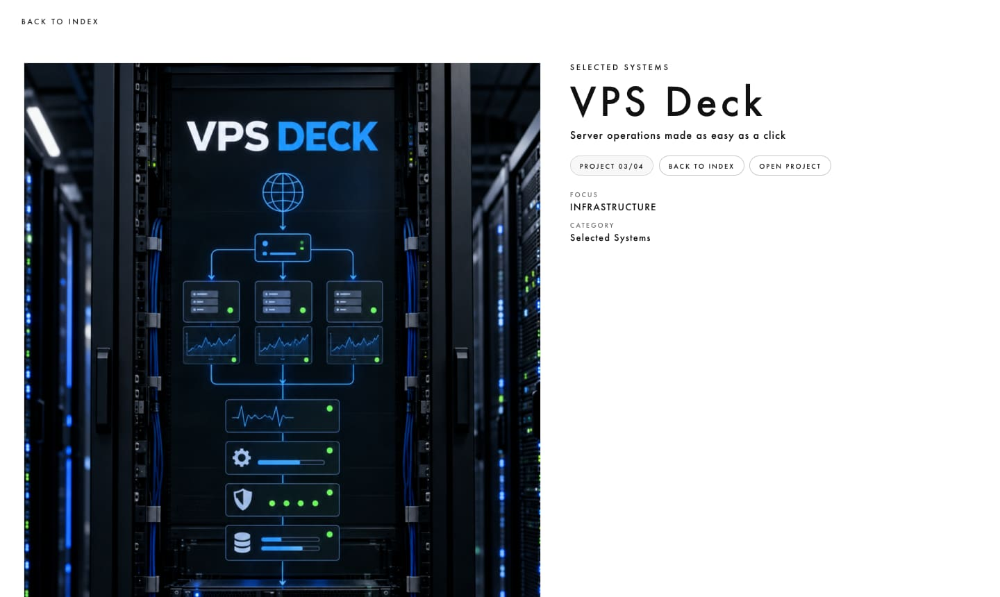
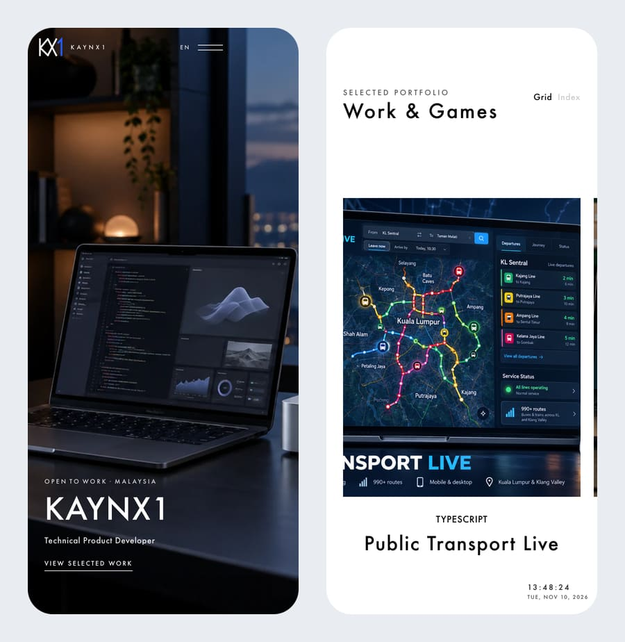
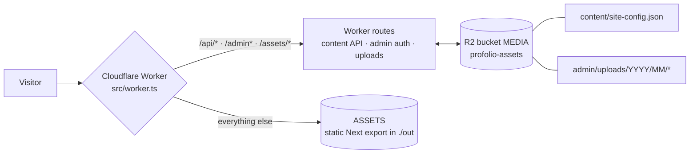
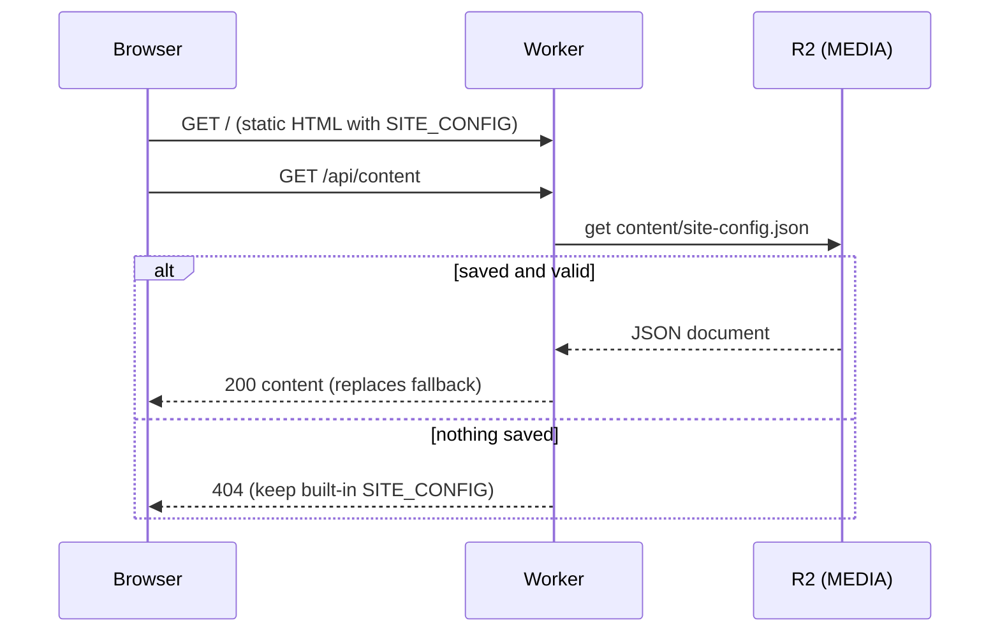
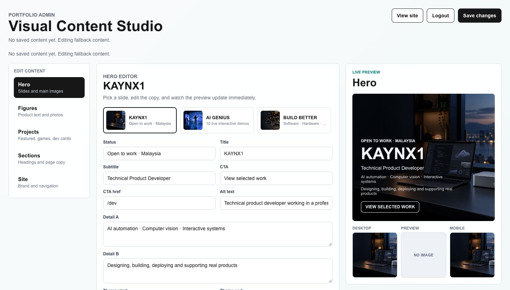

# Kaynx1 Portfolio

**A cinematic personal portfolio for Izzul Fitree, showing technical product development, AI automation, interactive games and business systems.** It is a static Next.js export served by a Cloudflare Worker, and has a built-in visual admin for editing content.




## Contents

- [Features](#features)
- [How it works](#how-it-works)
- [Quick start](#quick-start)
- [Admin panel](#admin-panel)
- [Configuration](#configuration)
- [Docker setup](#docker-setup)
- [Deploying to Cloudflare](#deploying-to-cloudflare)
- [Project structure](#project-structure)
- [Testing](#testing)
- [Troubleshooting](#troubleshooting)

## Features

### Cinematic hero slideshow

The home page is a full-screen slideshow. It advances automatically, and you can also move between slides by scrolling or with the slide tabs. Each slide has its own title, copy, call to action, theme colors, and separate desktop and mobile images. A first-load intro, route-transition overlays, an auto-hiding header and a full-screen navigation overlay complete the motion system. Smooth scrolling uses [Lenis](https://github.com/darkroomengineering/lenis).



### Work & Games carousel

`/dev` and `/games` show the projects in a horizontal carousel with wheel inertia and hover color. The **Grid / Index** toggle switches to a grouped index: Business Platforms, Infrastructure & Automation, AI & Computer Vision, Hardware Integrations, Security & Developer Tools, Creative Technology and Interactive Games.





### Project and figure pages

Every project gets a statically generated detail page at `/portfolio/[slug]`, with a summary, stack tags, a live-project link and a "next project" hand-off. Featured systems also appear as collectible-style "figures" under `/figures` and `/figures/[slug]`.

| Project detail | Figure detail |
|---|---|
|  |  |

### Built for mobile

Layouts, navigation and the carousel adapt to phone widths. On mobile the carousel keeps one complete project card in view. Motion respects `prefers-reduced-motion`.

<p align="center"></p>

### Other pages

`/about` (resume), `/contact`, `/news`, and a custom animated 404 page.

## How it works



The public pages are pre-rendered from the built-in `SITE_CONFIG` (`src/data/site-config.ts`). In the browser, the site then asks `/api/content` for saved admin content. If the admin has saved content to R2, that content replaces the fallback. If not, the fallback stays.



## Quick start

**Requirements:** Node.js 22 (the version the Dockerfile uses) and npm.

```bash
npm install
npm run dev          # Next.js dev server at http://localhost:3000 (public pages)
```

`npm run dev` serves the public site with the built-in content. The admin panel and `/api/*` need the Worker, so run the full stack locally like this:

```bash
cp .dev.vars.example .dev.vars   # then replace the placeholder values
npm run build                    # static export into ./out
npx wrangler dev --local         # Worker + assets + local R2 at http://localhost:8787
```

Open `/admin/login/` and sign in with the credentials from `.dev.vars`.

| Script | What it does |
|---|---|
| `npm run dev` | Next.js dev server |
| `npm run build` | Static export to `./out` |
| `npm run lint` | Type-check with `tsc --noEmit -p tsconfig.lint.json` |
| `npm run test:e2e` / `test:e2e:headed` | Playwright visual and motion QA |
| `npm run docker:up` / `docker:build` / `docker:down` | Docker Compose workflow |

## Admin panel

The portfolio is deployed as a static Next export behind a Cloudflare Worker. The public site uses the built-in `SITE_CONFIG` fallback until saved admin content exists in R2.

The **Visual Content Studio** at `/admin/` edits every part of the site with a live preview:

- **Hero:** slides, copy, theme colors, and desktop, preview and mobile images. Each image shows its recommended size and a check on the current image's size and shape.
- **Figures:** product text and photos.
- **Projects:** featured, games and dev cards.
- **Sections:** headings and page copy.
- **Site:** brand and navigation.



Admin content is saved to the R2 object `content/site-config.json` in `profolio-assets`. Uploaded images (JPEG, PNG, WebP or GIF, up to 8 MB) are saved under `admin/uploads/` and served through `/assets/...` with immutable caching.

Sessions use an HMAC-signed `HttpOnly`, `SameSite=Strict` cookie that lasts 12 hours. It is also marked `Secure` when served over HTTPS.

## Configuration

Admin credentials come from Worker variables: `.dev.vars` locally, and Wrangler secrets in production. Never commit `.dev.vars`; it is git-ignored.

| Variable | Purpose |
|---|---|
| `ADMIN_USERNAME` | Admin login username |
| `ADMIN_PASSWORD` | Admin login password |
| `ADMIN_SESSION_SECRET` | Long random secret used to sign the admin session cookie |
| `PROFOLIO_PORT` | Optional host port for Docker Compose (default `8787`) |

The Worker bindings are declared in `wrangler.jsonc`:

| Binding | Type | Used for |
|---|---|---|
| `ASSETS` | Static assets (`./out`) | The exported site. The Worker handles `/api/*`, `/admin*` and `/assets/*` first |
| `MEDIA` | R2 bucket `profolio-assets` | Saved content JSON and uploaded images |

## Docker setup

The Docker container builds the static Next export and runs the Cloudflare Worker locally through Wrangler.

```bash
cp .dev.vars.example .dev.vars
npm run docker:up
```

Open `http://localhost:8787/`, or from another device on the same LAN, `http://YOUR-MAC-IP:8787/`.

Useful commands:

```bash
npm run docker:build
npm run docker:down
```

Compose mounts `.dev.vars` read-only and keeps Wrangler's local state, including local R2, in the `profolio-wrangler-state` volume. Set `PROFOLIO_PORT` to publish a different host port.

## Deploying to Cloudflare

Set production credentials before deploying:

```bash
printf "admin" | npx wrangler secret put ADMIN_USERNAME
printf "your-password" | npx wrangler secret put ADMIN_PASSWORD
printf "your-long-random-secret" | npx wrangler secret put ADMIN_SESSION_SECRET
```

Then build and deploy the Worker together with the static assets:

```bash
npm run build
npx wrangler deploy
```

`wrangler.jsonc` binds the R2 bucket `profolio-assets` and routes the Worker on the `kaynx1.com` zone.

## Project structure

```text
app/                    Next.js App Router pages
  page.tsx              home (hero slideshow)
  dev/ games/ figures/  carousels and figure index
  portfolio/[slug]/     statically generated project pages
  figures/[slug]/       figure detail pages
  about/ contact/ news/ resume, contact and news pages
  admin/ admin/login/   Visual Content Studio + sign-in
  globals.css           design system and motion styles
src/
  components/           hero slideshow, carousels, header, nav overlay, loaders, admin UI
  context/              motion + site-content providers (fetches /api/content)
  data/site-config.ts   built-in SITE_CONFIG fallback content
  lib/content-schema.ts content validation, upload limits, R2 keys
  hooks/                use-reduced-motion
  worker.ts             Cloudflare Worker: content API, admin auth, uploads, assets
public/                 brand, hero, project, figure and game images
tests/                  Playwright QA specs
wrangler.jsonc          Worker, assets, R2 binding and route
Dockerfile, docker-compose.yml
```

## Testing

```bash
npx playwright install chromium   # first run only
npm run test:e2e                  # starts `npm run dev -- --port 3000` if nothing is running there
```

`tests/kaynx1-visual-qa.spec.ts` covers:

- the home loader, hero auto-slider, and nav open/hover
- hero click-through
- mobile nav toggles
- the resume layout on desktop and mobile
- figures-rail inertia, index view and idle clock
- carousel interactions for Work & Games
- the mobile one-card carousel

`playwright.local.config.ts` is the same setup without the built-in web server.

## Troubleshooting

- **The admin can't sign in, or `/api/*` returns 404, under `npm run dev`.** The API routes live in the Worker, not in Next.js. Use `npm run build && npx wrangler dev --local`, or Docker.
- **The admin login says the credentials are not configured.** `.dev.vars` is missing or incomplete. Copy `.dev.vars.example` and fill in all three values. In production, set them with `wrangler secret put`.
- **Admin changes don't appear on the site.** Click **Save changes**. The public site reads only content that has been saved to R2.
- **An image upload is rejected.** Only JPEG, PNG, WebP and GIF files up to 8 MB are accepted.
- **Docker Compose fails to start.** It bind-mounts `.dev.vars` and won't create it for you, so create the file first.
